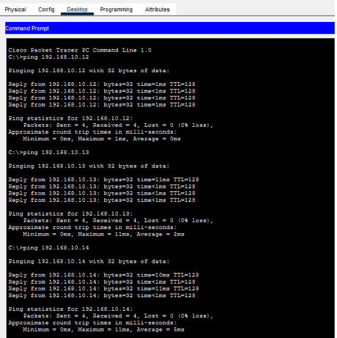
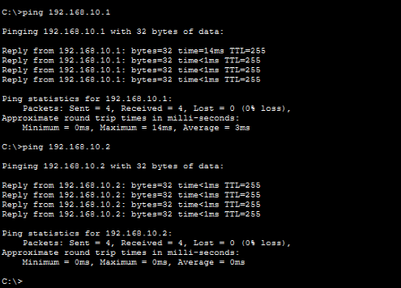

# Campus Network Design Using Cisco Packet Tracer

## Project Overview
A hierarchical campus network designed and simulated using Cisco Packet Tracer.

This project demonstrates the design of a structured network architecture connecting multiple end devices through access and distribution layers.

## Network Architecture

- **Access Layer:** AccessSW1 and AccessSW2
- **Distribution Layer:** Layer 3 Distribution Switch
- **Core/Edge Layer:** Edge Router
- **End Devices:** Four PCs

## Technologies Used
- Cisco Packet Tracer
- Network Switching
- Layer 2 and Layer 3 Networking
- Network Topology Design

## Key Concepts
- Hierarchical Network Architecture
- Layer 2 Switching
- Layer 3 Switching
- Network Redundancy
- Network Scalability
- Packet Flow Simulation

## Project File
You can download the complete Cisco Packet Tracer
project using the link below.

[Download Campus Network Design (.pkt)](./Campus_Network_Design.pkt)

Project Screenshots

## Author
Designed and implemented by me.
